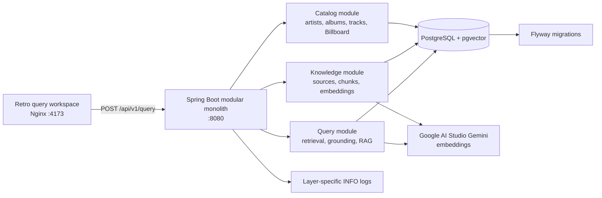
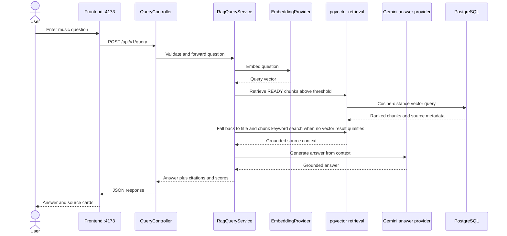

# Music Knowledge Assistant

A music knowledge assistant built with Java, Spring Boot, PostgreSQL, pgvector, and a retrieval-augmented generation (RAG) layer.

## Overview

The application follows a modular monolith architecture to keep the implementation maintainable while still supporting:

- structured music metadata in PostgreSQL
- semantic retrieval via pgvector
- LLM synthesis and explanation
- source-grounded answers
- observability, testing, and deployment support

## Current milestone

Completed stages include the repository/tooling foundation, music catalog and Billboard import, Wikipedia knowledge-source ingestion, document chunking, Gemini embedding generation, native pgvector retrieval, query-flow hardening and evaluation, and the retro query workspace.

## Architecture



The backend is a modular monolith. PostgreSQL stores structured catalog data, knowledge sources, chunks, and native `vector` embeddings. Retrieval uses vector similarity first, then falls back to keyword matching across source titles and chunk text when semantic retrieval finds no grounded source. Gemini is accessed behind provider interfaces, so tests can use deterministic fake providers. The frontend is a static Nginx site served by Docker Compose.

## Request flow



### Request flow, step by step

1. **The user submits a question.** The query workspace sends the text as JSON (`{"question":"..."}`) to `POST /api/v1/query`. The API validates that the question is present and not blank; invalid requests are rejected before retrieval begins.
2. **The backend creates a query embedding.** The retrieval service sends the question to the configured embedding provider and uses the resulting vector to search for relevant, grounded document chunks.
3. **Semantic retrieval selects candidate context.** With the default native-vector configuration, PostgreSQL/pgvector considers chunks whose embedding status is `READY` and whose similarity score meets the configured grounding threshold. It orders results by similarity and returns at most the configured `topK` count. If native pgvector is unavailable, the JSON-embedding path computes cosine similarity in the application and applies the same threshold and result limit.
4. **Keyword search is the fallback.** If semantic retrieval returns no qualifying chunks, the service searches source titles and chunk text using normalized question keywords. It ranks matching chunks, giving title matches extra weight, and returns up to `topK` results. This fallback is not used to supplement a non-empty semantic result set.
5. **The backend decides whether an answer can be generated.** If retrieval itself fails, the API returns a recovery message with an empty source list. If both semantic and keyword retrieval return no sources, it returns a not-enough-grounding message and does not call the answer generator.
6. **The answer provider synthesizes from retrieved sources.** When sources are available, the provider receives the original question and each source's title, URI, and chunk content. Gemini is instructed to use only this context, avoid inventing facts, and say when the sources do not support an answer. If generation fails, the API returns a generation-failure message while preserving the retrieved sources.
7. **The UI presents the answer and evidence.** A successful request returns JSON with an `answer` and a `sources` array. Each source includes its title, URI, content, and retrieval score. The workspace displays the answer and source cards with links and match scores, so users can inspect the material used to ground the response.

Query processing logs meaningful INFO events across the controller, embedding provider, retrieval store, and answer provider. They include model names, dimensions, source counts, and timing context without recording question text, source content, answers, or credentials.

## Local setup

Prerequisites:

- Java 21 and Maven 3.8+
- Docker Desktop with Compose
- Git Bash
- `curl` and `jq` for the sample ingestion script

1. Copy `.env.example` to `.env` and set `GEMINI_API_KEY` if you want real Gemini embeddings and answers.
2. Start the complete local stack:

```bash
docker compose up --build -d
```

3. Confirm the backend is healthy:

```bash
curl http://localhost:8080/actuator/health
```

4. Open the query workspace at `http://localhost:4173`. It is started by Docker Compose after the backend becomes healthy.

To run only the static frontend from Git Bash instead:

```bash
cd frontend && python -m http.server 4173
```

The frontend calls the backend query API at `http://localhost:8080`.

To stop the stack:

```bash
docker compose down
```

To stop it and remove the local PostgreSQL volume:

```bash
docker compose down -v
```

## Sample data ingestion

The Billboard fixture is [data/billboard-1980-1989-sample.csv](data/billboard-1980-1989-sample.csv). The backend accepts it through `POST /api/v1/catalog/imports/billboard` with `Content-Type: text/csv`.

The five Wikipedia summaries that correspond to the sample tracks are in [data/wikipedia-billboard-sample.json](data/wikipedia-billboard-sample.json). With the stack running, ingest and chunk them from Git Bash:

```bash
bash scripts/ingest-wikipedia-billboard-sample.sh
```

The script is idempotent by source URI. It creates or reuses each knowledge source and prepares its chunks. Embedding generation requires `GEMINI_API_KEY`.

## API surface

| Endpoint | Purpose |
| --- | --- |
| `GET /actuator/health` | Application, database, liveness, and readiness health |
| `POST /api/v1/query` | Ask a grounded music question |
| `POST /api/v1/evaluations/rag` | Evaluate answer and citation pass rates |
| `GET /api/v1/artists` | List catalog artists |
| `GET /api/v1/albums` | List catalog albums |
| `GET /api/v1/tracks` | List catalog tracks |
| `GET /api/v1/genres` | List catalog genres |
| `POST /api/v1/catalog/imports/billboard` | Import Billboard CSV rows |
| `GET,POST /api/v1/knowledge-sources` | List or create knowledge sources |
| `POST /api/v1/knowledge-sources/{id}/chunks` | Prepare document chunks |
| `POST /api/v1/knowledge-sources/{id}/embeddings` | Generate embeddings for chunks |

## Development checks

Run the backend test suite and package build:

```bash
cd backend
mvn spotless:apply
mvn clean test
mvn -DskipTests package
```

`mvn spotless:apply` removes unused imports and formats Java sources using Google Java Format. The formatting check also runs during `mvn verify`.

The suite covers catalog import, knowledge ingestion, chunking, embeddings, pgvector-compatible retrieval fallback, query hardening, evaluation, and the evaluation endpoint.

## Technology stack

- Java 21
- Spring Boot 4.x
- Spring Web
- Spring Data JPA
- Flyway
- PostgreSQL + pgvector
- Maven
- Docker + Docker Compose
- GitHub Actions

## Repository structure

```text
music-knowledge-assistant/
├── backend/
├── data/
├── docs/
├── infrastructure/
├── .github/
├── .env.example
├── docker-compose.yml
├── README.md
└── LICENSE
```

## Notes

- This project is intended for personal educational purposes only and should not be used for any other purpose.
- The native retrieval path uses pgvector in PostgreSQL; H2-based tests use the JSON embedding fallback.
- Wikipedia fixture content is concise, source-linked, and marked for CC BY-SA 4.0 attribution. Full article text is not copied into the repository.
