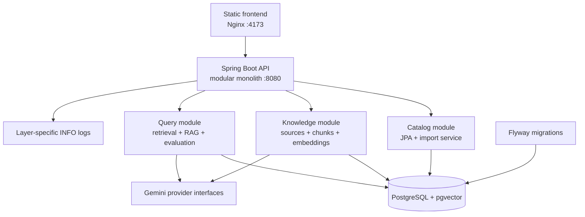
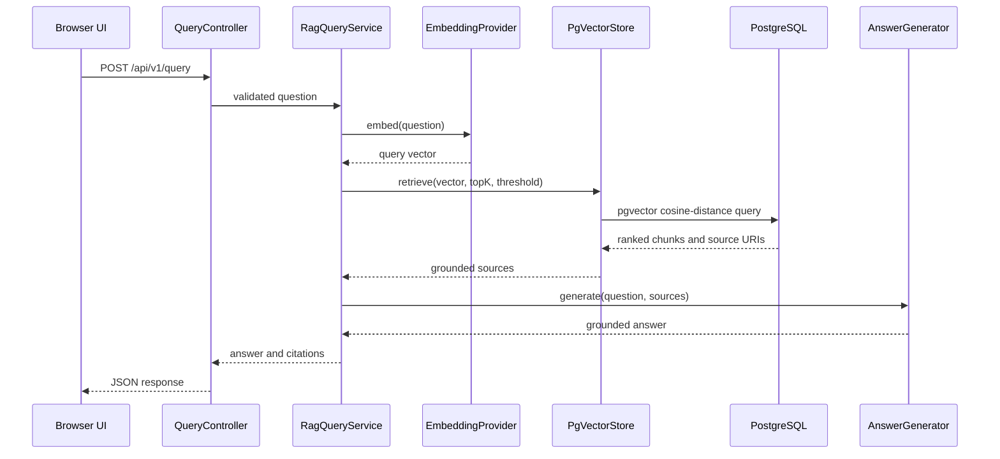

# Overview

This project implements a modular monolith for a music knowledge assistant. It combines structured relational music data with semantic retrieval over embeddings and an LLM for final synthesis.

## Goals

- Ground answers in authoritative metadata and knowledge documents.
- Prefer the right retrieval mechanism for each type of question.
- Keep the AI provider interchangeable behind well-defined interfaces.
- Maintain observability, evaluation, and testability from the start.

## Key design choices

- PostgreSQL stores the music catalog and structured facts.
- pgvector stores embeddings and knowledge chunks. Retrieval uses vector similarity first and title/chunk keyword matching as a fallback when no semantic result qualifies.
- The LLM is used for synthesis, explanation, and generation, not direct database access.
- Retrieval is hybrid: SQL + vector + reranking.
- The system is intentionally modular rather than split into entity microservices.

## Architecture diagram

## Request flow diagram

